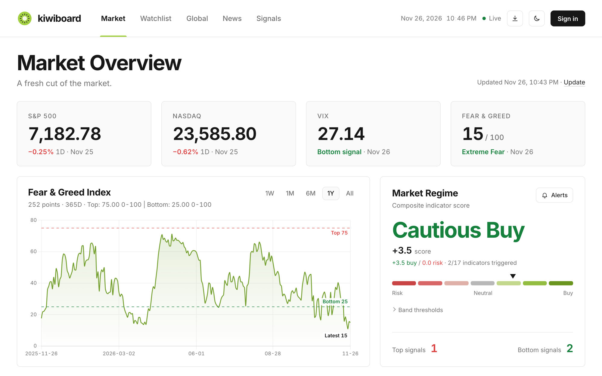
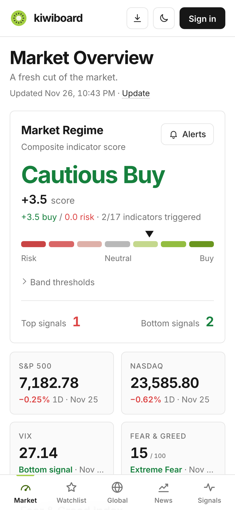
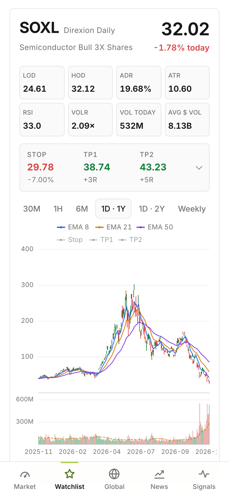
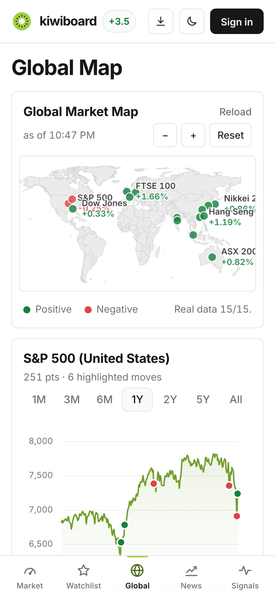
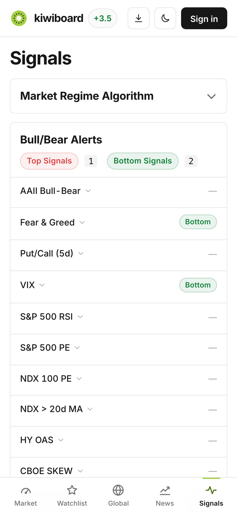

# kiwiboard

**A fresh cut of the market.** kiwiboard turns public market data into one
transparent score for timing risk and opportunity in US equities, with the
evidence behind every point of it. It runs in any browser and installs on
your phone as an app. Formerly *Poor Trader Dashboard*.

**Live: [poortrader.com](https://poortrader.com/)**

<picture>
  <source media="(prefers-color-scheme: dark)" srcset="docs/screenshots/desktop-dark.png">
  
</picture>

## On your phone

kiwiboard is a progressive web app. Open [poortrader.com](https://poortrader.com/)
on your phone, add it to your home screen, and it opens full screen like any
other app.

<table>
  <tr>
    <td width="25%"><picture><source media="(prefers-color-scheme: dark)" srcset="docs/screenshots/phone-market-dark.png"></picture></td>
    <td width="25%"><picture><source media="(prefers-color-scheme: dark)" srcset="docs/screenshots/phone-watchlist-dark.png"></picture></td>
    <td width="25%"><picture><source media="(prefers-color-scheme: dark)" srcset="docs/screenshots/phone-global-dark.png"></picture></td>
    <td width="25%"><picture><source media="(prefers-color-scheme: dark)" srcset="docs/screenshots/phone-signals-dark.png"></picture></td>
  </tr>
  <tr>
    <td align="center"><b>Market</b><br><sup>Regime first, then key numbers</sup></td>
    <td align="center"><b>Watchlist</b><br><sup>Trade plan and chart per stock</sup></td>
    <td align="center"><b>Global</b><br><sup>World indices at a glance</sup></td>
    <td align="center"><b>Signals</b><br><sup>Which indicators are firing</sup></td>
  </tr>
</table>

- **Install it.** On iPhone or iPad, open the site in Safari, tap Share, then
  *Add to Home Screen*. On Android, and in desktop Chrome or Edge, use the
  install icon in the header. The home-screen icon matches your light or dark
  mode.
- **Made for one thumb.** The tabs sit in a bottom bar (Market, Watchlist,
  Global, News, Signals), the regime score rides in the header, and charts use
  sparse axes and a zoom bar wide enough to drag.
- **Details on demand.** Explanations, long lists and secondary columns fold
  behind a tap, so every screen starts with the numbers.
- **Regime alerts.** Turn on notifications and kiwiboard tells you when the
  market regime moves into a new band, for example "Regime: Buy (+4.7)". You
  choose the bands; Neutral and Caution are off by default. On iPhone and iPad,
  notifications need iOS 16.4 or later and the home-screen app.
- **Your own watchlist.** Sign in with Google to keep a personal watchlist that
  follows you between phone and desktop. Add stocks by ticker or by company
  name ("apple" finds AAPL).
- **Light and dark.** Follows your system setting, or pick one in Settings.

Everything except a personal watchlist and alerts works without signing in.

## Signal track record

Signals are logged as dated calls, so the model can be checked against what
the market did next. Newest first.

### 2026-11-20 · Bottom call · Score +8.60 · Regime Buy

VIX 35.89 (+3.0) · F&G 9.67 (+3.0) · RSI 24.69 (+1.4) · S&P 500 PE 23.55 (+1.2)

**Buy +8.60 / Risk 0.00 → +8.60**, 4 of 17 indicators triggered: fear at
capitulation (F&G under 10), VIX above 30, RSI under 25 and valuation back
under 25× at the same time.

So far: the S&P 500 closed at 6,910.39 that day, its lowest close since
2026-04-13 and 11.6% below its 2026-10-06 high. It rose 4.7% the next session
and was 3.9% above the signal-day close on 2026-11-25. Too early to grade.

### 2026-03-30 · Bottom call · Score +6.40 · Regime Buy

VIX 30.6 (+3.0) · F&G 13.7 (+2.0) · NDX breadth 18.8% (+1.0) · AAII −21.6% (+0.7) · RSI 27.7 (+0.7) · Yield curve +0.53% (−1.0)

**Buy +7.40 / Risk −1.00 → +6.40**: volatility, fear, breadth and momentum all
near capitulation at the same time.

Outcome: the S&P 500 closed at 6,343.72 that day, its lowest close of 2026
through November. It was 13.6% higher a month later, 19.5% higher two months
later, and 23.3% higher at its 2026-10-06 high.

<sub>Outcomes use S&P 500 daily closes from Yahoo Finance. Top / risk calls
will be logged the same way.</sub>

## Why kiwiboard

Most market dashboards either bury you in unrelated charts or hand you a
black-box score. kiwiboard turns public market data into a decision framework
you can check:

- **Decision support, not automation.** The Poor2Rich score says whether the
  market looks closer to a bottom (buy, accumulate) or a top (take profit,
  drawdown risk). The decision stays yours.
- **A focused indicator set.** A small group of indicators with strong
  historical links to major US equity tops and bottoms, rather than every
  metric available.
- **Every input is auditable.** Each point of the score is itemised on
  screen, every indicator is plotted against its top and bottom thresholds,
  and every threshold was calibrated against the major US equity tops and
  bottoms since 2000.
- **Context next to the score.** Watchlist, global indices, big-move markers
  and news sit beside the model, so you can see whether a signal matches what
  the market is doing.
- **Free and fast.** Served from the edge, refreshed every 30 minutes, and no
  sign-in needed for the market data.

> A **Top** reading is treated as a *sell / take-profit* signal and a
> **Bottom** reading as a *buy / accumulate* signal. The thresholds come from
> the historical extremes around major US equity tops and bottoms since 2000;
> the Signals tab shows the numbers side by side.

## The tabs

### Market
The home page. The S&P 500, Nasdaq, VIX and Fear & Greed at a glance; the
indicator trend chart (tap any reading to chart it, from one week to all
history, against its top and bottom thresholds); the **Market Regime** card
with the live score, its band and the buy and risk points; and the
contribution of each indicator.

### Watchlist
- **Today's Special Focus** ranks the stocks with a daily setup or a base that
  held an edge in a 2018–2026 backtest of ~600 liquid US stocks: an EP gap
  (8%+ gap on 3× volume that holds), a tight pullback after a fast run, a
  quiet pullback to the rising 21-day EMA, and daily high tight flag, cup and
  cup-and-handle bases near their pivot. Volume surges, trend and relative
  strength show as tags but add no points (they only helped in hindsight).
- **Trade Plan** lists the next session's setups with the buy price, the stop
  and a share count for the risk you set. Your account size stays in your
  browser. When two or more of the regime's stress inputs fire, pullback
  setups are paused (they lost money in stressed markets).
- **Signal Record** logs every setup on the shared watchlist and grades it
  after each close, with the backtest's two exits (+3R target, or a 21 EMA
  trail): a live record with no survivorship bias.
- **Stock detail:** day range, ADR, ATR, RSI, relative volume and dollar
  volume; a trade plan with the entry, a structural stop (the signal day's
  low, or the pivot less one ATR, at most 7–8% away), +2R / +3R / +5R levels
  and hints if you already hold it; and a chart with EMA 8/21/50, volume and
  detected bases, from 30-minute to weekly bars.
- **Market Timing** checks SPY, QQQ and DIA against their 8/21/50-day EMAs
  (risk-on or risk-off).
- Drag rows to reorder, and add stocks by ticker or company name.

### Global
A world map of 15 major indices coloured by the day's move (tap one for its
headlines), and an index chart from one month to all history with the biggest
moves pinned to that day's news.

### News
Market headlines, a **Futures & Crypto** list and a **Stocks** list, both
with 1W / 1M / 3M / 1Y changes and sortable by any period. Futures & Crypto
starts with Bitcoin, gold and silver; add any crypto or futures contract by
name or symbol ("eth", "crude oil", "ES"). Tap a row for its chart and recent
news; the chart opens on Bitcoin. On a computer the lists and the chart sit
side by side, each half the width.

### Signals
How the regime score is built, the bull / bear rule for every indicator and
stress input and whether it is firing now, and the readings at every major
US equity top and bottom since 2000.

## Tracked Indicators

| Indicator | Why it matters |
|---|---|
| **US High Yield Option-Adjusted Spread (HY OAS)** | Cleanest credit-stress signal — credit usually moves before equities. |
| **CNN Fear & Greed Index** | Composite of seven sub-indicators of risk appetite. |
| **Put/Call Ratio (5-Day Average)** | Options positioning and hedging pressure. |
| **S&P 500 Price-to-Earnings (PE) Ratio** | Broad market valuation anchor. |
| **Nasdaq 100 PE Ratio** | Growth / tech valuation. |
| **S&P 500 RSI(14)** (Wilder smoothing) | Price momentum, overbought / oversold. |
| **Nasdaq 100 % Above 20-Day MA** | Short-term breadth thrust / capitulation. |
| **S&P 500 VIX** | Implied volatility / risk aversion. |
| **CBOE SKEW** | Institutional tail-risk hedging. |
| **10Y–2Y Treasury Yield Curve** | Late-cycle / Fed-easing detection. |

All values come from public sources (FRED, Yahoo Finance, CNN dataviz,
multpl, WorldPERatio). Nasdaq 100 and S&P 500 breadth are computed from the
members' daily closes after each US close. The regime's stress inputs also
read the real and nominal 10-year yields and the NFCI (FRED) and the MOVE
index (Yahoo). Each reading is timestamped, stored in D1, and
drawn on the front end with its top and bottom threshold lines. A reading
that stops updating is marked stale and left out of the score.

## The Poor2Rich Algorithm

The Poor2Rich algorithm produces a single signed score that classifies the
market into one of seven regimes, from **Strong Buy** to **Strong Risk**, and
explains itself with a per-input contribution breakdown. Version 2 (live
since 2026-11-28) scores the risk side on stress building instead of greed
levels.

### Formula

```
score = Σᵢ tier(xᵢ) × wᵢ  −  Σⱼ sⱼ × wⱼ
```

* `xᵢ` — the latest reading of indicator *i*
* `tier(xᵢ)` — a signed extremeness tier in `{-3, -2, -1, 0, +1, +2, +3}`,
  derived from how extreme the value is vs. its historical top/bottom
  thresholds (e.g. RSI < 25 = +2, F&G ≥ 85 = −2).
* `sⱼ` — stress input *j* firing at its first or second tier (`1` or `2`).
* `wᵢ`, `wⱼ` — quality weights reflecting how reliably each input has marked
  tops/bottoms historically.

Positive contributions push the score toward a **buy / bottom** bias;
negative contributions push toward a **top / risk** bias. Stress counts half
once the buy side reaches +4.5, so a panic low still reads as a buy.

### Indicator Weights

| Weight | Indicator | Rationale |
|---|---|---|
| 1.5 | VIX | Fear spikes (> 25). |
| 1.5 | HY OAS | Credit stress (≥ 4%). |
| 1.2 | S&P 500 PE | Valuation anchor. |
| 1.0 | CNN Fear & Greed | Composite sentiment. |
| 1.0 | Put/Call (5d) | Options-flow sentiment. |
| 1.0 | NDX > 20d MA | Washouts (< 20%). |
| 1.0 | 10Y–2Y Curve | Macro late-cycle. |
| 0.7 | S&P 500 RSI | Oversold (< 30). |
| 0.7 | NDX 100 PE | Less standard. |
| 0.6 | CBOE SKEW | Low hedging (≤ 135). |

Low VIX, high RSI, strong breadth and tight credit spreads no longer count
as tops: in tests back to 1990 they came *before* calmer markets, not
drawdowns. What did lead drawdowns was stress building, scored below.

### Stress Inputs

| Weight | Input | 1st / 2nd tier |
|---|---|---|
| 1.0 | Rate shock | Real 10Y +0.25 / +0.40 pp, or 10Y +0.40 / +0.60 pp, in 20 days |
| 1.0 | MOVE (bond volatility) | ≥ 110 / ≥ 130 |
| 1.5 | HY widening | +40 / +75 bp in 20 days, or +60 / +100 bp over the 60-day low |
| 1.0 | NFCI (financial conditions) | +0.05 / +0.10 in 4 weeks |
| 0.8 | CBOE SKEW | ≥ 150 / ≥ 160 |
| 1.0 | Narrow market | S&P 500 within 2% of its high, under 55% of members above the 50-day MA |

Replayed on 2026, this version read **Risk (−5.2)** on 2026-10-02, a week
before the October top, where the old score read Neutral, and still read
**Buy** at the November low. Details and the backtests:
`docs/algorithm-v2-plan.md` and `research/backtest/`.

### Regime Bands

| Band | Range |
|---|---|
| Strong Buy | ≥ +9.0 |
| Buy | +4.5 to +9.0 |
| Cautious Buy | +1.5 to +4.5 |
| Neutral | −1.5 to +1.5 |
| Caution | −4.5 to −1.5 |
| Risk | −9.0 to −4.5 |
| Strong Risk | ≤ −9.0 |

The regime card shows the active band, the buy and risk points, and which
indicators drove each side.

## Platform

- **Fresh data.** A Cloudflare cron pulls every source every 30 minutes and
  writes a heartbeat, so *Updated* always shows the latest run. The
  **Update** link pulls fresh data on demand (rate-limited).
- **Phone app.** Installable as a PWA. A small service worker makes the site
  installable, shows the last page when you're offline and delivers
  notifications; it never caches market data.
- **Regime alerts.** Sent from the Worker with Web Push. A band has to hold
  for two refreshes in a row before it's announced, and the same band isn't
  announced twice within 12 hours.
- **Optional accounts.** Google sign-in through Supabase. Personal watchlists
  and alert settings are stored in Supabase behind row-level security, and
  deleting your account in Settings deletes them too.
- **Open JSON API.** The public screens are backed by no-auth endpoints, so
  you can build your own bots, alerts or dashboards on top (see API).
- **Free tiers.** Cloudflare Workers, Pages and D1, plus Supabase.

## Architecture

```
                  every 30 min (cron)
  ┌──────────────┐ ───────────────▶ FRED · Yahoo · CNN · multpl · Finnhub …
  │  Cloudflare  │
  │    Worker    │ ── D1 (SQLite): observations, market_overview, watchlist,
  │ (TypeScript) │    watchlist_metrics, news_cache, kv_store
  └──────┬───────┘ ── Web Push (VAPID) ──▶ phones and browsers
         │ /api/* JSON
         ▼
  ┌──────────────┐     Google sign-in, personal watchlists,
  │  Pages PWA   │ ──▶ alert subscriptions (Supabase, row-level security)
  └──────────────┘
```

* **Frontend:** `cloudflare/pages/` — a single `index.html` (Chart.js for
  indicator history, ECharts for the map and stock / index charts), the
  service worker `sw.js`, web app manifests and icons.
* **Backend:** `cloudflare/worker/` (Cloudflare Worker + D1). Schema:
  `cloudflare/schema.sql`.
* **Accounts and alerts:** `supabase/schema.sql`.

## Running Locally

### Prerequisites

* Node 18+
* `npx wrangler` (or `npm i -g wrangler`)
* A Cloudflare account with D1 access (the free tier is enough)

### Worker (API)

```bash
cd cloudflare/worker
npm install

# First time: create the D1 database, paste the returned database_id into
# wrangler.toml, then apply the schema
npx wrangler d1 create poor-trader-db
npx wrangler d1 execute poor-trader-db --remote --file=../schema.sql

# Optional data keys (leave unset if you don't have them)
npx wrangler secret put FINNHUB_KEY    # stock, map and market news
npx wrangler secret put FRED_API_KEY   # HY OAS and the 10Y–2Y curve

npx wrangler dev       # local API on http://localhost:8787
npx wrangler deploy    # deploy
```

### Pages (frontend)

Point `window.API_BASE` (near the end of `cloudflare/pages/index.html`) at your
Worker, then deploy from `cloudflare/worker`:

```bash
npx wrangler pages deploy ../pages --project-name <your-pages-project>
```

### Sign-in and alerts (optional)

1. Create a Supabase project, turn on the Google provider and run
   `supabase/schema.sql`.
2. Put the project URL and publishable key in `wrangler.toml`
   (`SUPABASE_URL`, `SUPABASE_ANON_KEY`) and in `index.html`
   (`window.SUPABASE_URL`, `window.SUPABASE_ANON_KEY`).
3. Generate a VAPID key pair. The public key goes in `VAPID_PUBLIC_KEY` (in
   both `wrangler.toml` and `index.html`); the rest are secrets:

   ```bash
   npx wrangler secret put VAPID_PRIVATE_KEY
   npx wrangler secret put SUPABASE_SECRET_KEY
   npx wrangler secret put ADMIN_EMAILS     # who may edit the shared watchlist
   ```

4. `PUSH_ENABLED = "true"` in `wrangler.toml` turns sending on.

### Cron Schedule

Defined in `cloudflare/worker/wrangler.toml`:

```toml
[triggers]
crons = ["*/30 * * * *", "10 21,22,23 * * 1-5"]
```

- **Every 30 minutes:** indicators (VIX, SKEW, RSI, MOVE and the S&P 500's
  distance from its high in one Yahoo request; FRED series at most every 6
  hours), market rows, the shared watchlist and its signal log, then the
  regime score and its push alerts. Each run logs its outbound requests
  against the free plan's 50.
- **After the US close (21:10, 22:10, 23:10 UTC, weekdays):** Nasdaq 100
  breadth at the first run and S&P 500 breadth at the second (each is heavy,
  so they run apart), with the third run retrying whichever failed.

## API

| Endpoint | Description |
|---|---|
| `GET /api/latest` | Latest value per indicator with top/bottom flags. |
| `GET /api/alerts` | Bull/bear rule result per indicator. |
| `GET /api/regime` | Poor2Rich score, band, per-indicator contributions and the stress inputs. |
| `GET /api/signal-log` | The last 20 setups logged from the shared watchlist, graded, with their record. |
| `GET /api/indicator-history?indicator_id=…&days=…` | History of one indicator. |
| `GET /api/market-overview?symbols=AAPL,MSFT&assets=ETH-USD,CL=F` | Latest close plus 1W/1M/3M/1Y for indices, futures, crypto and stocks. |
| `GET /api/market-news` | General market headlines (Finnhub, with Yahoo Finance as a fallback). |
| `GET /api/stock-detail?symbol=…&range=1y` | Price history plus recent news (company news for stocks; Yahoo Finance news for crypto and futures). |
| `GET /api/world-indices` | Major world indices with the day's move and headlines. |
| `GET /api/index-history?symbol=…&range=…` | Index history with significant moves. |
| `GET /api/index-news?symbol=…&date=…` | News for an index on one day. |
| `GET /api/market-timing` | SPY, QQQ and DIA against their 8/21/50-day EMAs. |
| `GET /api/watchlist` | The shared watchlist with scores; `?symbols=…` scores any list. |
| `GET /api/stock-analysis?symbol=…&tf=d1y` | Bars, EMAs, volume and detected patterns for the stock chart. |
| `GET /api/symbol-search?q=…` | Ticker and company-name lookup (US stocks and ETFs first); `&kind=assets` searches crypto and futures. |
| `GET /api/status` | Heartbeat and which data keys are configured. |
| `POST /api/refresh` | Out-of-cycle data refresh (rate-limited per IP). |

Signed-in endpoints take the Supabase access token: `GET /api/me`,
`POST /api/push/test` and `DELETE /api/account`. Editing the shared watchlist
(`POST` / `DELETE /api/watchlist`, `POST /api/watchlist/reorder`,
`POST /api/watchlist/refresh`) is limited to `ADMIN_EMAILS`.

## Configuration

| Name | Kind | Purpose |
|---|---|---|
| `FRED_API_KEY` | secret | HY OAS and the 10Y–2Y yield curve from FRED. |
| `FINNHUB_KEY` | secret | Stock, map and market news. Free key at https://finnhub.io/register. |
| `SUPABASE_URL`, `SUPABASE_ANON_KEY` | vars | Google sign-in (both values are public). |
| `SUPABASE_SECRET_KEY` | secret | Lets the Worker read alert subscriptions and delete accounts. |
| `VAPID_PUBLIC_KEY`, `VAPID_SUBJECT` | vars | Web Push identity. |
| `VAPID_PRIVATE_KEY` | secret | Signs push messages. |
| `PUSH_ENABLED` | var | `"true"` sends regime alerts; anything else only tracks them. |
| `ADMIN_EMAILS` | secret | Accounts allowed to edit the shared watchlist. |

## History

kiwiboard continues **Poor Trader Dashboard** ("I trade therefore I poor.").
This repository keeps its stars, forks and full commit history. The last Poor
Trader Dashboard code is also kept as it was in
[poor-trader-dashboard-backup](https://github.com/WENHA0ZHANG/poor-trader-dashboard-backup).

## Disclaimer

This is a research / hobby project. The Poor2Rich score and bull/bear alerts
are *early-warning gauges* of sentiment and credit temperature — **not**
trading orders. Always combine them with position sizing and risk controls.

## License

kiwiboard is source-available under the
[PolyForm Noncommercial License 1.0.0](LICENSE). You may use, copy, modify and
share it for noncommercial purposes such as personal use, study, research and
hobby projects. Commercial use is not permitted; contact the author for a
commercial license.

Versions published earlier as Poor Trader Dashboard were released under
GPL-3.0 and remain available under those terms; a copy is kept in
[poor-trader-dashboard-backup](https://github.com/WENHA0ZHANG/poor-trader-dashboard-backup).
